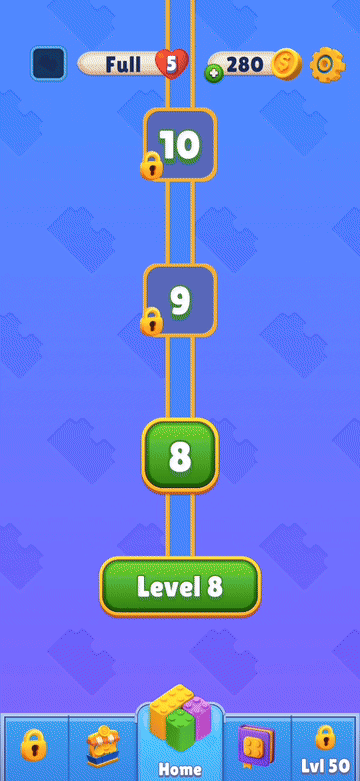
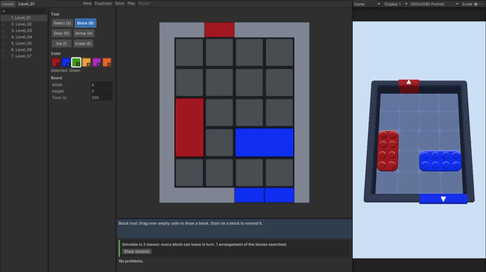

# rollic-case-study

A vertical slice of a block-sliding color puzzle for Android (portrait, 1080 x 1920): home screen, settings, levels with timer, coins, pause, restart and fail popup, and a visual level editor that every level is made with. The case's optional scope is in too: ice blocker, arrow block, functional boosters and the unsolvable-level warning.

As the first interview put weight on AI use, I used it openly and throughout this case. How the work was split is under [LLM tools](#llm-tools).

<p align="center"></p>

**APK:** [release build (Android)](https://drive.google.com/file/d/1dFhhKuSyOG2DK0qktpynnmioiQ18Pgct/view?usp=sharing)<br>
**Recordings:** [gameplay on a phone](https://drive.google.com/file/d/1PTZGCE_6eMDGmpmf7BZziAnKTXbK7S7f/view?usp=sharing) · [level editor](https://drive.google.com/file/d/1u-Y7e0oL8CRHLZ73Wk7HAJad93QDczft/view?usp=sharing)

## Open and run
- Unity **2022.3.62f2** with Android Build Support. Packages resolve on first open (VContainer, UniTask and UI Particle come from the OpenUPM registry in `Packages/manifest.json`).
- Open `Assets/Game/Runtime/Bootstrap/Scenes/Boot.unity` and press Play. Boot loads the app-wide services and opens Home; the level button starts the current level.
- Game view: 1080 x 1920 or any portrait size (20:9 and tablets are supported).
- Builds: **Build > Android APK (Release)** or **(Development)**; each build logs its size and largest assets.
- Tests: **Window > General > Test Runner > EditMode > Run All**.

## Scope

| Part | State |
|---|---|
| Home: level button, settings button, top UI, tab bar | Done. The middle tabs switch placeholder panels; avatar, lives and the coins' "+" are placeholders. |
| Settings: vibration, sound and music toggles, placeholder buttons, close | Done. Toggles are saved; vibration drives the haptics (button presses, grabbing and dropping a block, a block leaving) on iOS and Android 8+. |
| Gameplay: at least five levels, timer, coins, pause, restart, fail popup, home | Done. The timer starts on the first touch; coins are saved when the reward is taken. |
| Level editor: board size, doors, blocks, timer, save, play | Done, with undo, a level list, validation, a scene preview and Play from the editor. |
| Optional: unsolvable-level warning | Done. The editor solves the level after every change and asks before saving an unsolvable one. |
| Optional: ice blocker and arrow block | Done, in the game and in the editor. |
| Optional: functional boosters | Done: Freeze, Rocket, Hammer and Vacuum, with saved stock and a buy popup. |

## Level editor
**Game > Level Editor**, or double-click a level asset in `Assets/Game/Runtime/Levels/Levels/`.



**Make a level**
1. **New** (an empty board) or **Duplicate** (a copy of the open level).
2. Set **Width**, **Height** and **Time (s)** in the side panel.
3. Pick a color and draw blocks with the **Block** tool: drag over empty cells; start on a block to extend it.
4. Place doors with the **Door** tool on the frame; drag along the frame for a longer door.
5. Add ice or an arrow to a block if needed.
6. Fix what the problem list shows and press **Save**. The first save creates the level asset and adds it to the game as the last level.
7. **Play** saves the level and plays it in the game; the scenes you had open come back when play mode ends.

**Tools** (every button has a tooltip; the status line under the board says what a click on the hovered cell will do)

| Tool | Key | What it does |
|---|---|---|
| Select | S | Selects a block or door. Drag to move, click a color to recolor, Backspace deletes. |
| Block | B | Draws a block in the picked color. |
| Door | D | Places a door on the frame. |
| Arrow | A | Drag along a block's row or column: the block moves only that way. Click to remove. |
| Ice | I | Click a block to add one ice, right-click to take one off. |
| Erase | E | Erases block cells or a door. |

Keys 1 to 9 pick a color, L toggles the level list; shortcuts can be rebound in **Edit > Shortcuts**. Undo and redo (Ctrl/Cmd+Z, Ctrl/Cmd+Shift+Z) cover every change.

**Checks while editing**
- **Problems** lists errors, which block saving (overlapping blocks, a door off the frame and so on), and warnings (a block no door can let out). Each is marked on the board; clicking one selects its block or door.
- **Solver** says whether the level can be cleared without boosters. It checks quickly after every change; when that cannot decide, **Check fully** searches further under a cancelable progress bar. **Show solution** plays the fewest moves back on the board.
- An unsolvable level can still be saved, after a question.

**Level list:** search by number or name, drag to reorder, right-click to duplicate or delete.

**Scene preview:** with `Game.unity` open, the Scene view shows the open level (or the level asset selected in the Project window) as the game builds it. The preview is never saved into the scene.

## Architecture
Four assemblies with dependencies in one direction, so the compiler holds the separation of data, logic and view:

```
Game.Editor ──> Game ──> Game.Logic ──> Game.Data
                  │
                  └──> Core (Packages/com.base-setup.core)
```

- **Game.Data**: the level format and other saved data. The editor writes it, the game reads it.
- **Game.Logic**: the rules in plain C# with no engine reference (board, mechanics, drag, timer, boosters, coins), tested in EditMode without a scene.
- **Game**: views, input, flows, UI and the DI scopes. MonoBehaviours only show state and forward input.
- **Game.Editor**: the level editor and the build menu.
- **Core**: save, scenes, UI screens, pooling, audio, haptics and display; a package reused from earlier work.

Each feature has one entry class that the rest of the game calls, for example `PlaySession.Start(level, onWon, onFailed)`. Dependencies arrive through constructors (VContainer). No singletons, no event bus.

**One level, start to end**
1. `Boot` loads the app-wide services (save, coins, progress, audio) and opens `Home`; the level button switches to `Game`.
2. `GameEntry` picks the run (the player's current level, or the one sent from the editor) and calls `PlaySession.Start`.
3. `PlaySession` creates a `LevelAttempt`, the one rule object for a try: board, mechanics, drag and timer. `LevelStage` builds the board from pooled pieces and frames the camera.
4. `BoardInput` turns touches into calls on the attempt; after each change, `BoardPresenter.CatchUp` brings the views to the logic's state.
5. When the attempt is won or failed, `PlaySession` calls `GameEntry` back once. A win saves the reward and progress, then shows the next level; a fail offers retry or home. Restart is a new attempt; nothing carries over.

**Adding a mechanic**
- Logic: an `IMoveRule` and/or `IBlockGuard`, a field in the level data, one line in `LevelMechanics.For`, and a validator check if needed.
- Game: an `IBlockFeature` with a part on `Block.prefab`, and one line in `BlockFeatures.Of`.
- Editor: an `ILevelEditorTool` in `LevelEditorTools.Create` and an `IBlockMechanicDrawing` in the window's list.

The board, views and the editor's board drawing name no mechanic. Ice and the arrow block were added this way. The editor's edits, block selection and solution playback also know ice and the arrow, so a third mechanic touches them too.

**Adding a booster:** an `IBoardEffect` in the logic (what it does to the board), a `TargetedBooster` with its shot in the game, and one registration line in `PlayInstaller`. `TargetedBooster` fixes the order every aimed booster follows: aim, pick, apply, stock down, shot, catch up.

## Decisions
The main ones; every decision with its reason is in `Docs/Game/Decisions.md`.

### Four assemblies: Data, Logic, Game, Editor
The compiler checks the separation. `Game.Logic` has no engine reference, so every rule runs in EditMode tests without a scene, and the editor and the game share one level format. *Instead of* one assembly with folders, where a rule could reach a transform unchecked.

### One entry class per feature, no event bus
Other features know one class, so a feature changes inside without touching its callers, and `GameEntry` alone decides the flow. *Instead of* an event bus, which hides who reacts; it fits unrelated observers such as analytics, and the case has none.

### VContainer and a reused Core package
Constructors say what a class needs and each scene is composed in one place; VContainer is small, maintained and does not scan the scene. Save, scenes, UI screens, pooling and audio come from a tested package of earlier work, so the seven days went to the game and the editor. *Instead of* singletons or a service locator; Zenject, larger and unreleased since 2021.

### Mechanics and boosters plug in through small interfaces
The board asks `IMoveRule` and `IBlockGuard` at fixed points and views show a mechanic through an `IBlockFeature`; a booster is a tested board effect plus its animation. Ice, the arrow block and four boosters were added without changing the board or the views. *Instead of* a method per mechanic or booster on the board.

### The level editor is UI Toolkit only and edits a working copy
Bound fields follow undo by themselves, states live in USS and layout in UXML. Only a level without errors is written to its asset. *Instead of* IMGUI, where hover, selection and undo sync are written by hand.

### The solver runs on the game's own rules and warns, never refuses
A breadth-first search over every arrangement on the game's own board, so it cannot drift from the rules and finds the fewest moves. The editor asks before saving an unsolvable level but still saves it, as the case asks for a warning. *Instead of* a heuristic search, which cannot prove a level unsolvable.

### The levels are designed in the editor, at the reference's scale
The case asks for "the first 5 levels" without saying whether they must copy the reference game's first five layouts. They are read as the game's opening levels: the reference's first five set their scale (4 x 5 to 5 x 6 boards, two to six blocks, five minutes, 40 coins each), and the layouts were designed from scratch in the level editor, which the case requires the levels to come from.

## Performance
Nothing allocates in the drag path, the timer tick or the HUD's countdown, and board pieces and block views come from pools. On a low-end phone (Huawei Mate 20 Lite, Android 10) the game plays smoothly at 60 fps with no bottleneck found, so no further optimization pass was made.

## Known problems and incomplete parts
Visual polish was not prioritized, as it is not among the case's evaluation criteria.

- Buttons have no sound, only a press animation.
- Lives are shown but never spent.

## LLM tools
Claude Code (Anthropic, Pro plan) was used throughout, with a clear split of roles:
- **The developer decided and reviewed:** the first plan and the overall architecture, the folder structure, what to build and in what order; reviewed the code, pointed out structures that went wrong and proposed how to change them; edited the prefabs; designed the levels in the level editor; tried every step in the editor and on a device.
- **Claude Code did the mechanical work:** wrote the code, the tests and the docs following those decisions, ran compiles, tests and editor scripts in batch mode, studied the reference game on a device over adb, and ran independent code reviews in a separate agent.
- **Written by Claude Code and not edited by hand:** the tests, the level editor's UI Toolkit code and the shader code. They were checked by running them, not line by line.

## Work time
About 30 to 35 hours over the seven days (2026-11-16 to 2026-11-22), roughly 4 to 5 hours a day in short sessions. Time was not tracked per session, so this is an estimate.

## Third-party code
No paid or commercially licensed assets were used on purpose: everything below, along with VContainer, UniTask and DOTween (the free edition, not DOTween Pro), is free and openly licensed.

- [Quick Outline](https://github.com/chrisnolet/QuickOutline) by Chris Nolet, MIT license, in `Assets/Plugins/QuickOutline/` with its license file. The commit that adds it holds the original files; this project's changes follow in their own commits and are listed at the top of `Outline.cs`.
- [UI Particle](https://github.com/mob-sakai/ParticleEffectForUGUI) by mob-sakai, MIT license, 4.14.2 from OpenUPM (`com.coffee.ui-particle`): draws the win screen's confetti, a ParticleSystem, inside the UI canvas.
- [Lilita One](https://fonts.google.com/specimen/Lilita+One) by Juan Montoreano, SIL Open Font License 1.1, in `Assets/Plugins/LilitaOne/` with its license file and the TextMesh Pro font asset made from it: the font of every screen, as the supplied assets have none.

## Feedback on the supplied assets
- **The block models are too tall.** The pieces are about 1.6 units deep, while a block reads as a plate a quarter of a cell thick. Sunk into the ground they look right from above, but the held block's outline wraps the whole mesh, including the part below the board, and no longer matches the reference; scaled down to a plate's height, the studs on top turn flat. The project makes flat plates from the supplied pieces in Blender (`Tools/Blender/make_block_plates.py`).
- **The models do not share one orientation.** Block pieces and arrows face `-Z`, the ground tile `+Y`, the frame bars `-Y`, so each file needs its own rotation to lie on the board.
## Documentation
`Docs/00-Index.md` maps the rest: case requirements, conventions, the Core package's systems and one note per game system.
